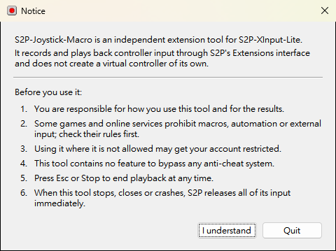
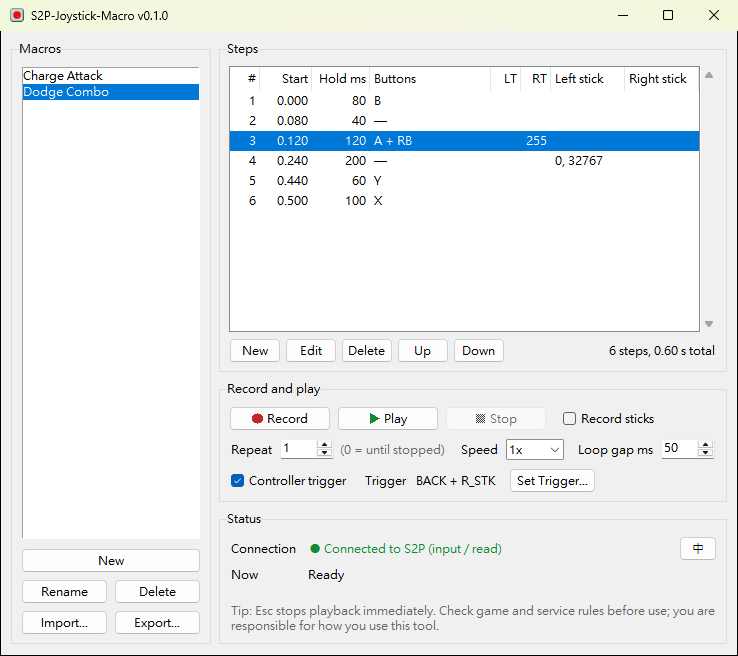
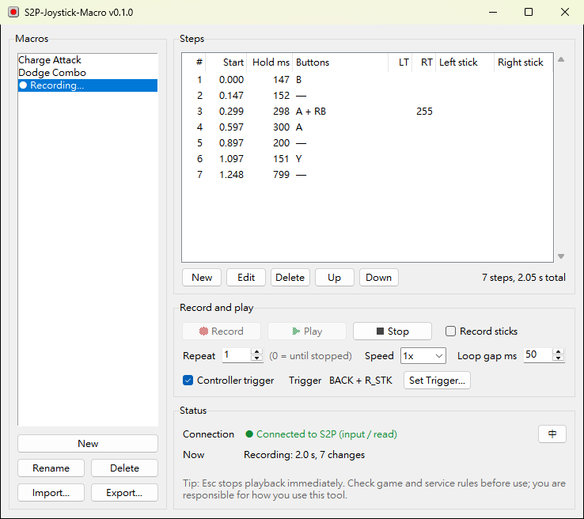
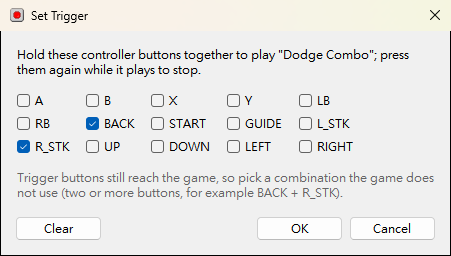
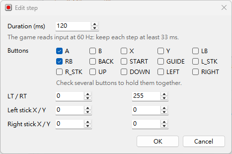

# S2P-Joystick-Macro User Guide

[繁體中文](USER_GUIDE_zh-TW.md) · [S2P-Extensions User Guide](../../manual/USER_GUIDE.md)

S2P-Joystick-Macro records controller buttons, triggers and sticks, and plays
them back through S2P-XInput-Lite. It is an extension tool: it does not create
a virtual controller of its own and does not modify S2P.

Installing the tool, adding it in S2P, permissions and connection problems are
covered in the [S2P-Extensions User Guide](../../manual/USER_GUIDE.md). This
guide covers the tool itself.

## Contents

- [1. First launch](#1-first-launch)
- [2. The window](#2-the-window)
- [3. Recording](#3-recording)
- [4. Playback](#4-playback)
- [5. Controller trigger](#5-controller-trigger)
- [6. Editing steps](#6-editing-steps)
- [7. Managing macros](#7-managing-macros)
- [8. Running in the background](#8-running-in-the-background)
- [9. Troubleshooting](#9-troubleshooting)

## 1. First launch

### 1.1 Permissions in S2P

| Feature | Permission needed in S2P |
|---|---|
| Play macros | **Allow input** (on by default) |
| Record macros | **Allow reading controller state** |
| Controller trigger | **Allow reading controller state** |

See [S2P-Extensions User Guide 2.2](../../manual/USER_GUIDE.md#22-permissions).

### 1.2 Notice

The first launch shows a notice about responsibility and game rules. Choose
**I understand** to start using the tool, or **Quit** to close it. The notice is
not shown again after you accept it. If S2P starts the tool in the background
before you have accepted, the notice still appears first.

## 2. The window

| Area | Contents |
|---|---|
| **Macros** (left) | The macro list, with **New**, **Rename**, **Delete**, **Import...** and **Export...** below it. |
| **Steps** (top right) | The selected macro's steps. Each row is one state of buttons, triggers and sticks, and how long it is held. |
| **Record and play** (middle right) | Recording, playback and trigger settings. |
| **Status** (bottom right) | **Connection** to S2P, what the tool is doing **Now**, and the 中 / En language switch. |

Step table columns:

| Column | Meaning |
|---|---|
| **#** | Step number. |
| **Start** | When the step starts, in seconds from the beginning of the macro. |
| **Hold ms** | How long the step is held, in milliseconds. |
| **Buttons** | Buttons held during the step; **—** means nothing is pressed. |
| **LT** / **RT** | Trigger values (0–255); empty means released. |
| **Left stick** / **Right stick** | Stick position (X, Y from −32768 to 32767); empty means the macro does not move that stick. |

**Connection** shows **Connected to S2P** with the granted permissions while the
tool is connected, and **Waiting for S2P-XInput-Lite…** while it is not.

## 3. Recording

1. Select **Record**. A **● Recording…** entry appears in the macro list, and
   the step table shows each change as it is recorded.
2. Use the physical controller. Timing starts at the first input, so the idle
   time before it is not recorded.
3. Select **Stop**, or press **Esc** while the tool's window is active.
4. The new macro is named **Rec** followed by the date and time; select
   **Rename** to change it.

- Recording captures S2P's output after stick curves, gyro and button mapping.
  It never includes input from extension tools, so playback is not recorded
  again.
- Buttons and triggers are always recorded. Check **Record sticks** to record
  the sticks as well; small movements near the center are ignored.
- If nothing was pressed, no macro is created and **Now** shows **No input was
  recorded.**

## 4. Playback

1. Select a macro in the list.
2. Set the options:

   | Option | Meaning |
   |---|---|
   | **Repeat** | How many times to play the macro; 0 repeats until stopped. |
   | **Speed** | 0.25x to 2x. |
   | **Loop gap ms** | How long all input is released between repeats (default 50), so a repeated button counts as a new press in the game. |

3. Select **Play**. **Now** shows the pass and step being played.
4. Select **Stop**, or press **Esc** while the tool's window is active, to stop
   at once. All of the macro's input is released immediately.

- You can keep using the physical controller during playback. Buttons are
  combined, and a moving physical stick takes priority over the macro.
- When a macro moves a stick, the tool takes control of that stick only while
  it plays and gives it back afterwards. If another extension tool is
  controlling that stick, the stick moves are skipped and **Now** says so.

## 5. Controller trigger

A controller trigger starts a macro when you hold a button combination on the
controller.

1. Select a macro and choose **Set Trigger...**.
2. Check the buttons to hold together, for example **BACK** + **R_STK**, and
   select **OK**. **Clear** removes the macro's trigger.
3. Make sure **Controller trigger** is checked (on by default).
4. Hold the combination to play the macro; hold it again while it plays to
   stop.

- Trigger buttons still reach the game. Choose a combination the game does
  not use, ideally two or more buttons.
- A combination can belong to only one macro. When several match at once, the
  one with the most buttons wins.
- Triggers are not detected while recording.
- Without **Allow reading controller state** in S2P, triggers do not work and
  **Now** says so.

## 6. Editing steps

Use the buttons below the step table:

| Button | Action |
|---|---|
| **New** | Add a step after the selected one, or at the end when none is selected. |
| **Edit** | Edit the selected step (or double-click it). |
| **Delete** | Delete the selected steps. |
| **Up** / **Down** | Move the selected step. |

In the **Edit step** window you can set the duration, the buttons held, LT /
RT (0–255) and both sticks (X, Y from −32768 to 32767). Every change is saved
at once.

A step is the whole controller state for its duration, not a single button.
Check several buttons to hold them together; the table shows them as
`A + B`. To hold A and tap B, list A in every step: `A`, then `A + B`, then
`A`. A recording starts a new step at every change, so two buttons pressed a
few milliseconds apart are recorded as a short step with only the first
button before the `A + B` step.

A game reads the controller a fixed number of times a second, at moments
that do not line up with the macro, and S2P adds tool input to the
controller's next report. A step can fall between two reads, so keep each
step at least two of the game's reads long. How often a game reads input is
not always its frame rate: many fighting and action games read 60 times a
second even when the screen runs at 144 FPS.

Choose the game's rate in **Game input rate** under the step table; the
**?** next to it explains it. Steps that play shorter than this at the
current **Speed** are shown in orange, with a count next to the setting.
When the macro repeats, a too short **Loop gap ms** is flagged the same
way (its label turns orange):

| Game input rate | Steps shown in orange |
|---|---|
| 30 Hz | under 66 ms |
| 60 Hz (default) | under 33 ms |
| 144 Hz or more | under 16 ms |

If you are not sure, keep 60 Hz, or test the game: make a macro with one
10 ms press, set **Repeat** to 20 and **Loop gap ms** to 100 or more (longer
than the action's cooldown), and count how many presses the game reacts to,
for example with ammo, typed letters or a training mode input display.
About 6 means 30 Hz, about 12 means 60 Hz, and all 20 means 144 Hz or more.
[Playback timing](../../docs/playback-timing.md) has the measurements.

## 7. Managing macros

- **New** creates an empty macro, **Rename** renames the selected macro, and
  **Delete** deletes it after confirmation.
- **Export...** saves the selected macro as a JSON file to share or back up.
  **Import...** adds a macro from such a file; a name that already exists gets
  a number added.
- Macros are stored in the `macros\` folder next to `S2P-Joystick-Macro.exe`,
  and settings in `settings.json` in the same folder. Keep them when you
  upgrade.

## 8. Running in the background

- The X button does not quit: the window goes to the notification area, the
  tool stays connected to S2P, and controller triggers keep working.
- Click the notification area icon or choose **Show** to bring the window
  back. Right-click it and choose **Quit** to close the tool.
- Only one copy runs at a time. Starting the EXE again, or choosing **Open** in
  S2P, brings back the running copy's window.
- Once the tool is enabled in S2P, S2P starts it in the background when the
  connection starts, and closing S2P closes the tool too. See
  [S2P-Extensions User Guide 4](../../manual/USER_GUIDE.md#4-starting-and-closing).

## 9. Troubleshooting

| Problem | What to do |
|---|---|
| **Record** says S2P does not allow reading controller state | Check **Allow reading controller state** for this tool in S2P's Extensions window. |
| **Play** says S2P does not allow this tool to submit input | Check **Allow input** for this tool in S2P. |
| **Now** shows **No input was recorded.** | Press a button or trigger after selecting **Record**. To record only stick movement, check **Record sticks**. |
| The game misses short presses | Lengthen the orange steps (check **Game input rate**), or play at a lower **Speed**. |
| A repeated button counts as one long press | Increase **Loop gap ms**. |
| Stick moves are skipped | Another extension tool controls that stick; disable it or remove its stick use. |
| The trigger does nothing | Check **Controller trigger**, set a combination with **Set Trigger...**, and allow reading controller state in S2P. |
| The window does not appear when the EXE starts | The tool is already running in the notification area; click its icon. |

Connection messages such as **unauthorized** are explained in the
[S2P-Extensions User Guide](../../manual/USER_GUIDE.md#5-troubleshooting).
