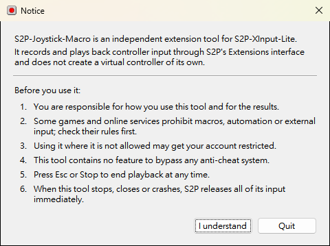
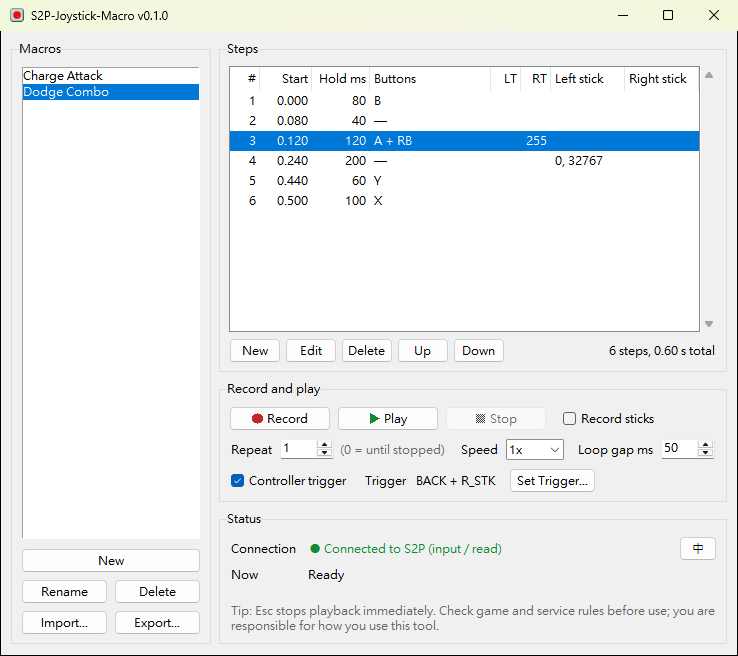
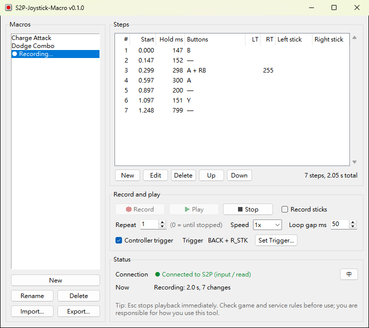
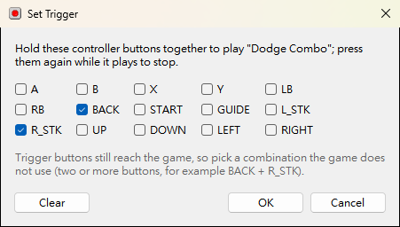
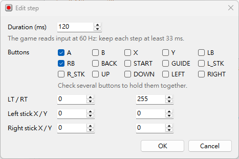

# S2P-Joystick-Macro 使用手冊

[English](USER_GUIDE.md) · [S2P-Extensions 使用手冊](../../manual/USER_GUIDE_zh-TW.md)

S2P-Joystick-Macro 會錄製手把按鍵、扳機與搖桿操作，並透過 S2P-XInput-Lite 播放。它是擴充工具，
本身不建立虛擬手把，也不修改 S2P。

安裝、在 S2P 新增工具、權限與連線問題，請看 [S2P-Extensions 使用手冊](../../manual/USER_GUIDE_zh-TW.md)；
本手冊只說明工具本身的操作。

截圖為英文介面，括號內附上中文介面的名稱。按右下角的 **中** / **En** 可切換介面語言。

## 目錄

- [1. 第一次使用](#1-第一次使用)
- [2. 視窗介紹](#2-視窗介紹)
- [3. 錄製](#3-錄製)
- [4. 播放](#4-播放)
- [5. 手把觸發](#5-手把觸發)
- [6. 編輯步驟](#6-編輯步驟)
- [7. 管理巨集](#7-管理巨集)
- [8. 在背景執行](#8-在背景執行)
- [9. 疑難排解](#9-疑難排解)

## 1. 第一次使用

### 1.1 S2P 中的權限

| 功能 | S2P 需要開啟的權限 |
|---|---|
| 播放巨集 | **Allow input**（允許提交輸入，預設開啟） |
| 錄製巨集 | **Allow reading controller state**（允許讀取控制器狀態） |
| 手把觸發 | **Allow reading controller state**（允許讀取控制器狀態） |

見 [S2P-Extensions 使用手冊 2.2](../../manual/USER_GUIDE_zh-TW.md#22-權限)。

### 1.2 使用聲明

第一次啟動會顯示責任歸屬與遊戲規範的使用聲明。按 **I understand**（我已了解）開始使用，按 **Quit**（結束）
則關閉工具。同意後不會再顯示。若 S2P 在你同意之前就於背景啟動工具，仍會先顯示使用聲明。

## 2. 視窗介紹

| 區域 | 內容 |
|---|---|
| **Macros**（巨集，左側） | 巨集清單，下方有 **New**（新增）、**Rename**（重新命名）、**Delete**（刪除）、**Import...**（匯入）、**Export...**（匯出）。 |
| **Steps**（步驟，右上） | 目前巨集的步驟。每一列是一組按鍵、扳機與搖桿狀態，以及持續多久。 |
| **Record and play**（錄製與播放，右中） | 錄製、播放與觸發設定。 |
| **Status**（狀態，右下） | 與 S2P 的 **Connection**（連線）、工具 **Now**（目前）在做什麼，以及中／En 語言切換。 |

步驟表格的欄位：

| 欄位 | 說明 |
|---|---|
| **#** | 步驟編號。 |
| **Start**（開始） | 這一步從巨集開始後第幾秒開始。 |
| **Hold ms**（持續 ms） | 這一步持續多久（毫秒）。 |
| **Buttons**（按鍵） | 這一步按住的按鍵；**—** 表示沒有按任何鍵。 |
| **LT** / **RT** | 扳機數值（0–255）；空白表示放開。 |
| **Left stick** / **Right stick**（左搖桿／右搖桿） | 搖桿位置（X、Y 範圍 −32768 到 32767）；空白表示巨集不控制這支搖桿。 |

**Connection**（連線）在連上時顯示 **Connected to S2P**（已連接 S2P）與取得的權限，未連上時顯示
**Waiting for S2P-XInput-Lite…**（等待 S2P-XInput-Lite…）。

## 3. 錄製

1. 按 **Record**（錄製）。巨集清單會出現 **● Recording…**（錄製中…），步驟表格會即時顯示錄到的每個變化。
2. 操作實體手把。計時從第一個輸入開始，之前的閒置時間不會被錄進去。
3. 按 **Stop**（停止），或在工具視窗為作用中時按 **Esc**。
4. 新巨集會以 **Rec** 加上日期時間命名，可按 **Rename**（重新命名）修改。

- 錄到的是 S2P 經過搖桿曲線、陀螺儀與按鍵映射後的輸出，不包含擴充工具送出的輸入，所以播放內容不會被重複錄進去。
- 按鍵與扳機一定會錄製。勾選 **Record sticks**（錄製搖桿）才會一併錄製搖桿；中心附近的微小移動會被忽略。
- 若完全沒有輸入，不會建立巨集，**Now**（目前）會顯示 **No input was recorded.**（沒有錄到任何輸入。）

## 4. 播放

1. 在清單選取一個巨集。
2. 設定選項：

   | 選項 | 說明 |
   |---|---|
   | **Repeat**（重複次數） | 播放幾次；0 表示不停重複，直到停止。 |
   | **Speed**（速度） | 0.25x 到 2x。 |
   | **Loop gap ms**（循環間隔 ms） | 每次重複之間放開所有輸入的時間（預設 50），讓重複的按鍵在遊戲中算成新的一次按下。 |

3. 按 **Play**（播放）。**Now**（目前）會顯示正在播放第幾次、第幾步。
4. 按 **Stop**（停止），或在工具視窗為作用中時按 **Esc**，可立即停止並放開巨集的所有輸入。

- 播放時仍可使用實體手把：按鍵會合併，推動實體搖桿時以實體搖桿優先。
- 巨集有搖桿動作時，工具只在播放期間取得那支搖桿的控制權，播完就交還。若那支搖桿正由其他擴充工具控制，
  搖桿動作會被略過，**Now**（目前）會顯示原因。

## 5. 手把觸發

手把觸發可以在手把上按住組合鍵時播放巨集。

1. 選取巨集，按 **Set Trigger...**（設定觸發鍵）。
2. 勾選要同時按住的按鍵，例如 **BACK** + **R_STK**，按 **OK**。**Clear**（清除）會移除這個巨集的觸發鍵。
3. 確認已勾選 **Controller trigger**（啟用手把觸發，預設開啟）。
4. 按住組合鍵即播放巨集；播放中再按住一次則停止。

- 觸發鍵仍會傳給遊戲，請選擇遊戲中用不到的組合，建議兩個以上按鍵。
- 同一組按鍵只能給一個巨集使用。同時符合多組時，以按鍵數最多的那組優先。
- 錄製期間不偵測觸發鍵。
- S2P 未允許讀取控制器狀態時，觸發不會作用，**Now**（目前）會顯示提示。

## 6. 編輯步驟

使用步驟表格下方的按鈕：

| 按鈕 | 功能 |
|---|---|
| **New**（新增） | 在選取的步驟後面新增一步；沒有選取時加在最後。 |
| **Edit**（編輯） | 編輯選取的步驟（也可以直接雙擊）。 |
| **Delete**（刪除） | 刪除選取的步驟。 |
| **Up** / **Down**（上移／下移） | 移動選取的步驟。 |

在 **Edit step**（編輯步驟）視窗可以設定持續時間、按住的按鍵、LT / RT（0–255）與左右搖桿（X、Y 範圍 −32768
到 32767）。每次修改都會立即儲存。

一個步驟代表這段時間內整支手把的狀態，不是單一按鍵。勾選多個按鍵就是同時按住，表格會顯示成 `A + B`。
要按住 A 的同時點一下 B，每一步都要列出 A：`A`、`A + B`、`A`。錄製時狀態每改變一次就會開新步驟，
所以相隔幾 ms 按下的兩個按鍵，會在 `A + B` 之前多出一個只有第一個按鍵的短步驟。

遊戲每秒以固定次數讀取手把，讀取時間點和巨集不同步，S2P 也是在手把下一份報告時才併入工具輸入；
步驟可能剛好落在兩次讀取之間，所以每個步驟建議至少保持遊戲讀取 2 次的時間。遊戲讀取輸入的頻率
不一定等於畫面 FPS：許多格鬥與動作遊戲即使畫面跑 144 FPS，仍固定每秒讀 60 次。

在步驟表格下方的 **Game input rate**（遊戲讀取輸入）選擇遊戲的頻率，旁邊的 **?** 有說明。
較短的步驟會以橘色顯示，設定旁也會列出數量：

| 遊戲讀取輸入 | 以橘色顯示的步驟 |
|---|---|
| 30 Hz | 短於 66 ms |
| 60 Hz（預設） | 短於 33 ms |
| 144 Hz 以上 | 短於 16 ms |

不確定時維持 60 Hz，或實際測試：建立只有一步 10 ms 短按的巨集，**Repeat**（重複次數）設 20、
**Loop gap ms**（循環間隔 ms）設 100 以上（要比該動作的冷卻時間長），再數遊戲反應了幾次，例如看彈藥數、
輸入的字數或訓練模式的按鍵紀錄。約 6 次是 30 Hz，約 12 次是 60 Hz，20 次全中是 144 Hz 以上。
量測數據見[播放時間精準度](../../docs/playback-timing_zh-TW.md)。

## 7. 管理巨集

- **New**（新增）建立空白巨集，**Rename**（重新命名）修改名稱，**Delete**（刪除）會先確認再刪除。
- **Export...**（匯出）把選取的巨集存成 JSON 檔，方便分享或備份；**Import...**（匯入）從這種檔案加入巨集，
  名稱重複時會自動加上編號。
- 巨集存在 `S2P-Joystick-Macro.exe` 旁的 `macros\` 資料夾，設定存在同一資料夾的 `settings.json`。升級時請保留。

## 8. 在背景執行

- 按視窗右上角的 X 不會結束程式：視窗會縮到系統匣，持續連線 S2P，手把觸發仍然有效。
- 在系統匣圖示按左鍵或選 **Show**（顯示）叫回視窗；按右鍵選 **Quit**（結束）才會關閉工具。
- 程式只會同時執行一份。再開一次 EXE 或在 S2P 按 **Open**（開啟），會叫回原本的視窗。
- 在 S2P 啟用本工具後，S2P 連線開始時會在背景啟動它，關閉 S2P 時工具也會一起關閉。見
  [S2P-Extensions 使用手冊 4](../../manual/USER_GUIDE_zh-TW.md#4-啟動與關閉)。

## 9. 疑難排解

| 狀況 | 處理方式 |
|---|---|
| 按 **Record**（錄製）時提示 S2P 未允許讀取控制器狀態 | 在 S2P 的擴充工具視窗為本工具勾選 **Allow reading controller state**（允許讀取控制器狀態）。 |
| 按 **Play**（播放）時提示 S2P 未允許提交輸入 | 在 S2P 為本工具勾選 **Allow input**（允許提交輸入）。 |
| **Now**（目前）顯示沒有錄到任何輸入 | 按下 **Record**（錄製）後要按按鍵或扳機。只想錄搖桿時，請勾選 **Record sticks**（錄製搖桿）。 |
| 遊戲沒讀到很短的按鍵 | 加長橘色的步驟（確認 **Game input rate**（遊戲讀取輸入）設定），或降低 **Speed**（速度）。 |
| 重複的按鍵被當成一直按住 | 加大 **Loop gap ms**（循環間隔 ms）。 |
| 搖桿動作被略過 | 另一個擴充工具正在控制那支搖桿；停用它或取消它的搖桿控制。 |
| 手把觸發沒有反應 | 勾選 **Controller trigger**（啟用手把觸發），用 **Set Trigger...**（設定觸發鍵）設定組合，並在 S2P 允許讀取控制器狀態。 |
| 開啟 EXE 沒有出現視窗 | 工具已在系統匣執行，請點系統匣圖示。 |

**未授權** 等連線訊息的說明，請看 [S2P-Extensions 使用手冊](../../manual/USER_GUIDE_zh-TW.md#5-疑難排解)。
