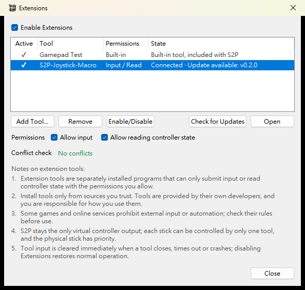

# S2P-Extensions User Guide

[繁體中文](USER_GUIDE_zh-TW.md) · [S2P-XInput-Lite](https://github.com/duoduo-88/S2P-XInput-Lite)

This guide covers what all S2P-Extensions tools share: installing them,
connecting them in S2P-XInput-Lite, permissions, connection states, and
troubleshooting. Each tool has its own guide for using the tool itself.

| Tool | Guide |
|---|---|
| S2P-Joystick-Macro: record, play back and edit controller input | [S2P-Joystick-Macro User Guide](../macro/manual/USER_GUIDE.md) |

## Contents

- [1. Getting started](#1-getting-started)
- [2. Connecting tools in S2P](#2-connecting-tools-in-s2p) (including [updates](#25-checking-for-updates))
- [3. How tool input is combined](#3-how-tool-input-is-combined)
- [4. Starting and closing](#4-starting-and-closing)
- [5. Troubleshooting](#5-troubleshooting)
- [6. Responsibility](#6-responsibility)

## 1. Getting started

### 1.1 Requirements

- Windows 10 or 11.
- [S2P-XInput-Lite](https://github.com/duoduo-88/S2P-XInput-Lite) **v0.8.2 or
  later**. Tools connect through its **Extensions** window, which earlier
  versions do not have.

### 1.2 Installation

1. Download `S2P-Extensions-<version>.zip` from the
   [Releases](https://github.com/duoduo-88/S2P-Extensions/releases) page.
2. Extract it anywhere and keep the **S2P-Extensions** folder together.

```text
S2P-Extensions\
├─ README.md, README_zh-TW.md
└─ S2P-Joystick-Macro\
   ├─ S2P-Joystick-Macro.exe
   ├─ S2P-Joystick-Macro.s2p.json   version and update address for S2P
   └─ README.md, README_zh-TW.md
```

The user guides are not in the ZIP; the READMEs link to them online.

Each tool keeps its settings and data in its own folder, so moving a tool
folder moves its data too. After moving an EXE, add it again in S2P (see 2.1).

Keep each `.s2p.json` file next to its EXE with the same name; S2P reads it
to check the tool for updates (see 2.5).

To upgrade, close the tools, then replace the old EXE and `.s2p.json` files
with the new ones.
Keep the existing data files in each tool folder (for S2P-Joystick-Macro:
`macros\` and `settings.json`).

## 2. Connecting tools in S2P



### 2.1 Add and enable a tool

1. In S2P-XInput-Lite, select **Extensions** at the bottom of the main window.
2. Select **Add Tool...** and choose the tool's EXE, for example
   `S2P-Joystick-Macro\S2P-Joystick-Macro.exe`. A new tool is enabled in the
   list right away. You can add several tools; up to 4 can be enabled at the
   same time.
3. Select the tool in the list and set its **Permissions** (see 2.2).
4. Select **Open** to show the tool's window.

Use **Enable/Disable** to turn a tool off without removing it, and **Remove**
to take it out of the list. Only EXEs in the list (or tools that S2P started)
may connect.

### 2.2 Permissions

| Permission | Default | What it allows |
|---|---|---|
| **Allow input** | On | The tool may send button, trigger and stick states to S2P. |
| **Allow reading controller state** | Off | The tool may read S2P's controller output, for example to record it or to watch for a trigger combination. |

Grant only what the tool needs; each tool's guide lists its requirements.
After a permission change the tool reconnects by itself.

### 2.3 Conflict check

**Conflict check** lists every problem that keeps a tool from working as
expected:

- In the settings: the same EXE added twice, more than 4 enabled tools, or a
  tool without any permission.
- While tools run: a tool that was refused a stick because another tool
  controls it (listed until that tool releases the stick), a tool that asks
  for a permission you have not allowed, a second copy of a running tool,
  a program that is not in the list trying to connect, and another program
  holding S2P's pipe.

Running tools are checked only while the S2P connection runs. Buttons and
triggers never conflict: buttons are combined and triggers take the
larger value.

### 2.4 Connection states

| State in S2P | Meaning |
|---|---|
| **Disabled** | This tool is disabled in the list. |
| **Waiting for connection** | S2P is waiting for the tool. Also shown while the S2P connection is not running. |
| **Connected** | The tool is connected. "input timed out" means the tool was silent for over 1 s and its input was cleared. |
| **Disconnected** | The tool closed. |
| **Connection failed** | Unauthorized, missing permission, stick conflict, incompatible version, or tool not found. |

### 2.5 Checking for updates

Select **Check for Updates** in the Extensions window. S2P asks each tool's
update source whether a newer version exists and adds the result to the
**State** column:

| Shown | Meaning |
|---|---|
| **Update available: vX.Y.Z** | A newer version exists. S2P offers to open its download page. |
| **Up to date** | The installed version is the latest. |
| **No update info** | No `.s2p.json` file next to the EXE, or it names no update source. |
| **Update check failed** | The update source could not be reached or did not list the tool. |

S2P checks only when you select the button and never downloads or installs
anything itself. To update, download the new release and follow 1.2.

## 3. How tool input is combined

S2P stays the only virtual Xbox controller. It combines tool input with the
physical controller in the one report it already sends; rumble, stick curves,
gyro and button mapping keep working as before.

- **Buttons**: pressed while the controller or any tool holds them.
- **Triggers**: the largest value wins.
- **Sticks**: each stick can be controlled by only one tool, and the physical
  stick has priority. Moving the physical stick takes over at once; the tool
  gets the stick back about 0.15 s after it returns to the center.
- When a tool closes, times out or crashes, S2P clears its input immediately.
  Buttons you still hold and other tools are not affected.

## 4. Starting and closing

- **Starting with S2P**: when the S2P connection starts, or when you enable a
  tool, S2P starts every enabled tool in the background. No window appears;
  the tool connects by itself and waits in the notification area.
- **Showing a tool**: select it in the Extensions window and choose **Open**,
  or click its name in S2P's notification area menu. If the tool is already
  running, its existing window comes forward; no second copy starts.
- **Closing a tool**: closing the tool's window with X usually only hides it
  to the notification area. Use the tool's own notification area menu to quit.
- **Closing S2P**: closing S2P-XInput-Lite closes its tools too. Restarting
  only the S2P connection keeps them running.

## 5. Troubleshooting

| Problem | What to do |
|---|---|
| The tool says **Waiting for S2P-XInput-Lite…** | Make sure S2P-XInput-Lite v0.8.2 or later is running, its connection is started, and the tool is enabled in the Extensions list. |
| **unauthorized** | Add this exact EXE in S2P's Extensions window. A copy in another folder counts as a different tool. |
| **another extension tool controls the same stick** | Another enabled tool claimed that stick. Disable one of them or let one tool control the stick. |
| **S2P granted no permission** | Check at least one permission for the tool in S2P. |
| **disconnected manually in S2P** | Select the tool in S2P and choose **Open**. |
| **another copy of this tool is running** | Close the other copy, or use the one that is already running. |
| **incompatible protocol version** | Update S2P-XInput-Lite and the tool to matching releases. |
| A feature needs reading but nothing happens | Check **Allow reading controller state** for the tool in S2P. |
| Input gets stuck or a game behaves oddly | Close the tool or disable it in S2P's Extensions list; S2P clears its input at once. |

## 6. Responsibility

- These tools are provided by this project and released separately from the
  S2P-XInput-Lite main program.
- You are responsible for how you use them and for the results.
- Some games and online services prohibit macros, automation or external
  input. Check their rules before use; using them where it is not allowed may
  get your account restricted.
- This project provides no feature to bypass any anti-cheat system.
