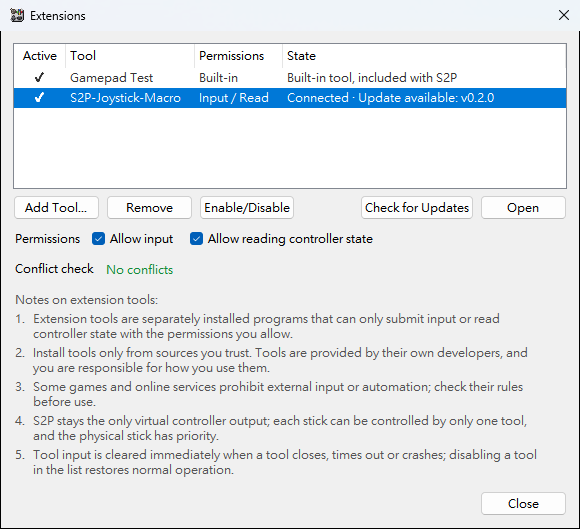

# S2P-Extensions 使用手冊

[English](USER_GUIDE.md) · [S2P-XInput-Lite](https://github.com/duoduo-88/S2P-XInput-Lite)

本手冊說明所有 S2P-Extensions 工具共通的部分：安裝、在 S2P-XInput-Lite 連接工具、權限、連線狀態與疑難排解。
各工具本身的操作，請看各自的手冊。

| 工具 | 手冊 |
|---|---|
| S2P-Joystick-Macro：錄製、播放、編輯手把操作 | [S2P-Joystick-Macro 使用手冊](../macro/manual/USER_GUIDE_zh-TW.md) |

截圖為英文介面，括號內附上中文介面的名稱。

## 目錄

- [1. 開始使用](#1-開始使用)
- [2. 在 S2P 連接工具](#2-在-s2p-連接工具)（含 [檢查更新](#25-檢查更新)）
- [3. 工具輸入如何合併](#3-工具輸入如何合併)
- [4. 啟動與關閉](#4-啟動與關閉)
- [5. 疑難排解](#5-疑難排解)
- [6. 責任歸屬](#6-責任歸屬)

## 1. 開始使用

### 1.1 系統需求

- Windows 10 或 11。
- [S2P-XInput-Lite](https://github.com/duoduo-88/S2P-XInput-Lite) **v0.8.2 以上**。工具透過它的
  **Extensions**（擴充工具）視窗連線，舊版沒有這個功能。

### 1.2 安裝

1. 到 [Releases](https://github.com/duoduo-88/S2P-Extensions/releases) 頁面下載 `S2P-Extensions-v<版本>.zip`。
2. 解壓縮到任意位置，並保持 **S2P-Extensions** 資料夾完整。

```text
S2P-Extensions\
├─ README.md、README_zh-TW.md
└─ S2P-Joystick-Macro\
   ├─ S2P-Joystick-Macro.exe
   ├─ S2P-Joystick-Macro.s2p.json   給 S2P 讀取的版本與更新網址
   └─ README.md、README_zh-TW.md
```

使用手冊不在 ZIP 內，README 裡有線上手冊的連結。

每個工具的設定與資料都存在自己的資料夾裡，搬移工具資料夾時資料會一起搬走。搬移 EXE 後，請在 S2P
重新新增（見 2.1）。

請讓每個 `.s2p.json` 檔和同名的 EXE 放在一起，S2P 會讀取它來檢查工具更新（見 2.5）。

升級時先關閉工具，再用新版 EXE 與 `.s2p.json` 取代舊檔。請保留各工具資料夾內原有的資料檔（S2P-Joystick-Macro 是
`macros\` 與 `settings.json`）。

## 2. 在 S2P 連接工具



### 2.1 新增並啟用工具

1. 在 S2P-XInput-Lite 主視窗底部按 **Extensions**（擴充工具）。
2. 按 **Add Tool...**（新增工具）選擇工具 EXE，例如 `S2P-Joystick-Macro\S2P-Joystick-Macro.exe`，
   加入後即在清單中啟用。可以加入多個工具，最多同時啟用 4 個。
3. 在清單選取工具，設定 **Permissions**（權限，見 2.2）。
4. 按 **Open**（開啟）顯示工具視窗。

**Enable/Disable**（啟用／停用）可暫時停用工具而不移除，**Remove**（移除）會把它移出清單。
只有清單中的 EXE（或由 S2P 啟動的工具）才能連線。

### 2.2 權限

| 權限 | 預設 | 允許的動作 |
|---|---|---|
| **Allow input**（允許提交輸入） | 開啟 | 工具可以把按鍵、扳機與搖桿狀態交給 S2P。 |
| **Allow reading controller state**（允許讀取控制器狀態） | 關閉 | 工具可以讀取 S2P 的控制器輸出，例如用來錄製或偵測觸發組合鍵。 |

只給工具需要的權限，各工具手冊會列出它需要哪些權限。權限變更後工具會自動重新連線。

### 2.3 衝突檢查

**Conflict check**（衝突檢查）會列出所有讓工具無法正常運作的問題：

- 設定：同一個 EXE 重複加入、啟用超過 4 個工具、沒有任何權限的工具。
- 執行中：工具要求控制某支搖桿，但已由其他工具控制而被拒絕（顯示到對方放開搖桿為止）、工具要求的權限未允許、
  同一個工具開了第二份、不在清單中的程式嘗試連線，以及 S2P 的通訊管道被其他程式占用。

執行中的檢查只在 S2P 連線啟動時進行。按鍵與扳機不會衝突：按鍵合併，扳機取較大值。

### 2.4 連線狀態

| S2P 顯示的狀態 | 說明 |
|---|---|
| **Disabled**（未啟用） | 此工具已在清單中停用。 |
| **Waiting for connection**（等待連線） | S2P 正在等待工具連線；S2P 連線未啟動時也會顯示。 |
| **Connected**（已連接） | 工具已連線。若顯示「輸入逾時」，表示工具超過 1 秒沒有回應，其輸入已清除。 |
| **Disconnected**（已中斷） | 工具已關閉。 |
| **Connection failed**（連線失敗） | 未授權、權限不足、搖桿衝突、版本不相容或找不到工具。 |

### 2.5 檢查更新

在擴充工具視窗按 **Check for Updates**（檢查更新）。S2P 會向每個工具的更新來源查詢是否有新版本，並把結果加在
**State**（狀態）欄：

| 顯示 | 說明 |
|---|---|
| **Update available: vX.Y.Z**（有更新） | 有新版本，S2P 會詢問是否開啟下載頁面。 |
| **Up to date**（已是最新版本） | 已安裝的就是最新版本。 |
| **No update info**（未提供更新資訊） | EXE 旁沒有 `.s2p.json` 檔，或檔案內沒有更新來源。 |
| **Update check failed**（更新檢查失敗） | 無法連到更新來源，或更新來源沒有列出這個工具。 |

只有按下按鈕時才會檢查，S2P 也不會自行下載或安裝任何東西。要更新時，下載新版 release 後依 1.2 操作。

## 3. 工具輸入如何合併

S2P 仍是唯一的虛擬 Xbox 手把，工具的輸入會併入 S2P 原本就送出的那一份報告；震動、搖桿曲線、陀螺儀與
按鍵映射都照常運作。

- **按鍵**：手把或任一工具按住時就輸出。
- **扳機**：取最大值。
- **搖桿**：每支搖桿只能由一個工具控制，且實體搖桿優先。推動實體搖桿會立即接手，搖桿回到中心約
  0.15 秒後才交還給工具。
- 工具關閉、逾時或當機時，S2P 會立即清除它的輸入，不影響你仍按住的按鍵，也不影響其他工具。

## 4. 啟動與關閉

- **跟著 S2P 啟動**：S2P 連線開始時（或剛啟用工具時），S2P 會在背景啟動所有已啟用的工具。不會跳出視窗，
  工具自行連線並待在系統匣。
- **顯示工具**：在擴充工具視窗選取工具按 **Open**（開啟），或在 S2P 的系統匣選單點工具名稱。工具已在執行時
  會叫回原本的視窗，不會開第二份。
- **關閉工具**：按工具視窗的 X 通常只會縮到系統匣，要用工具自己的系統匣選單結束。
- **關閉 S2P**：關閉 S2P-XInput-Lite 時，工具也會一起關閉；只重新啟動 S2P 連線則不會。

## 5. 疑難排解

| 狀況 | 處理方式 |
|---|---|
| 工具顯示 **等待 S2P-XInput-Lite…** | 確認 S2P-XInput-Lite v0.8.2 以上正在執行、已開始連線，且工具在擴充工具清單中為啟用。 |
| **未授權** | 在 S2P 的擴充工具視窗加入這個 EXE。放在其他資料夾的複本會被視為不同工具。 |
| **與其他擴充工具搶同一支搖桿** | 另一個已啟用的工具佔用了這支搖桿。停用其中一個，或只讓一個工具控制搖桿。 |
| **S2P 未給予任何權限** | 在 S2P 為這個工具至少勾選一項權限。 |
| **已在 S2P 中手動中斷** | 在 S2P 選取這個工具，按 **Open**（開啟）。 |
| **此工具已有另一份在執行** | 關閉另一份，或直接使用已在執行的那一份。 |
| **協定版本不相容** | 把 S2P-XInput-Lite 與工具更新到相容的版本。 |
| 需要讀取的功能沒有反應 | 在 S2P 為這個工具勾選 **Allow reading controller state**（允許讀取控制器狀態）。 |
| 輸入卡住或遊戲行為異常 | 關閉工具，或在 S2P 擴充工具清單停用它；S2P 會立即清除它的輸入。 |

## 6. 責任歸屬

- 這些工具由本專案提供，與 S2P-XInput-Lite 主程式分開發佈。
- 使用工具所產生的操作與結果由使用者自行負責。
- 部分遊戲或線上服務禁止巨集、自動化或外部輸入。使用前請先確認相關規範；在不允許的情況下使用，可能導致帳號受限。
- 本專案不提供任何規避反作弊系統的功能。
